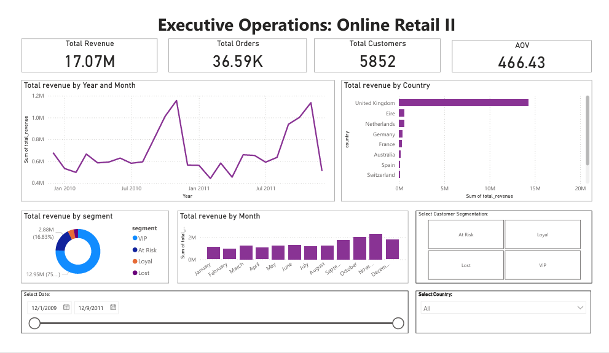
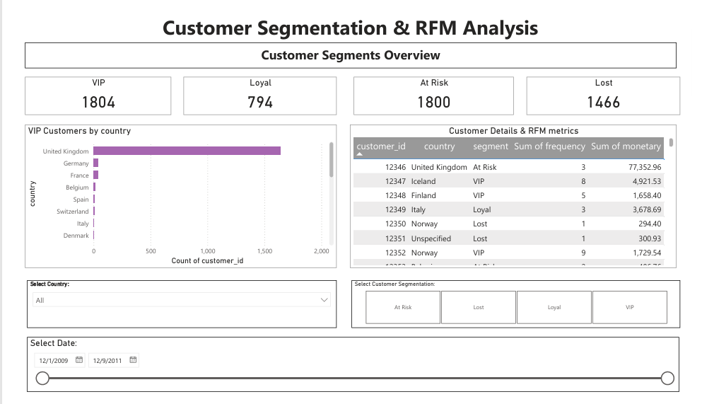
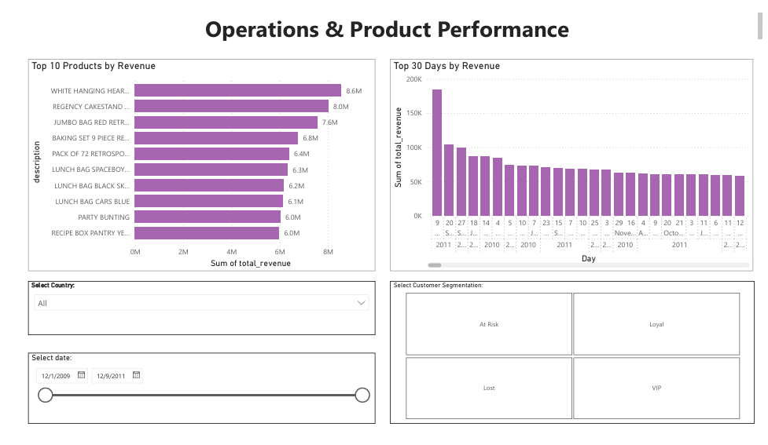

# Online Retail II: End-to-End Data Analytics & Business Intelligence Project

## 📌 Project Overview
This project is a complete, end-to-end data analytics pipeline built on the **Online Retail II** dataset. The goal was to transform a messy, real-world dataset of over 1 million transactions into a scalable data warehouse and an interactive Power BI dashboard to drive business decisions.

**The Business Questions:**
- Who are our most valuable customers (RFM Analysis)?
- What is the customer retention rate over time (Cohort Analysis)?
- Which customers are likely to churn, and what drives that behavior?
- Which products and countries generate the most revenue?

## 🛠 Tech Stack & Tools
- **Data Processing & EDA:** Python (Pandas, NumPy, Matplotlib, Seaborn)
- **Machine Learning:** Scikit-Learn (Random Forest, Feature Engineering)
- **Database & Data Warehousing:** PostgreSQL, SQL
- **Data Transformation (ELT):** dbt (Data Build Tool) - Star Schema modeling
- **Business Intelligence:** Power BI (DAX, Data Modeling)

---

## 🚀 Project Architecture & Workflow

The project follows a modern data stack architecture:
1. **Data Ingestion & Cleaning:** Raw data is cleaned using Python.
2. **Data Warehousing (dbt):** Data is loaded into PostgreSQL and transformed using dbt into a Star Schema.
3. **Advanced Analytics:** RFM Segmentation, Cohort Analysis, and Churn Prediction.
4. **Visualization:** A 3-page interactive Power BI dashboard.

---

## 🧗 Challenges & Key Learnings

### 1. The "Data Leakage" Trap in Machine Learning
**The Challenge:** I built a Random Forest model to predict customer churn that achieved a suspicious **100% accuracy**. 
**The Solution:** I realized I had included the `Recency` feature in the training data—the exact variable I used to define "Churn". I removed it, and the model dropped to a realistic **63.5% accuracy**. 
**The Lesson:** Real-world ML is about building models that learn patterns, not memorizing rules.

### 2. The Power of dbt & Data Modeling
Instead of writing massive SQL scripts, I used **dbt** to build a modular, layered data warehouse (Staging, Intermediate, Marts). This ensured data quality and made the data ready for Power BI.

---

## 📊 Power BI Dashboard Overview
Here is a glimpse of the 3-page interactive dashboard:

**Page 1: Executive Overview**

**Page 2: Customer Segmentation & RFM**

**Page 3: Operations & Product Performance**

---

## 📂 Repository Structure
- `data/`: Raw and processed datasets
- `notebooks/`: Jupyter notebooks for EDA, Cleaning, RFM, and ML
- `src/`: Python scripts for data loading
- `dbt/`: dbt project (Models, Schema)
- `powerbi/`: Power BI Dashboard file (.pbix)
- `reports/figures/`: Dashboard screenshots

## ⚙️ How to Run
1. Install requirements: `pip install -r requirements.txt`
2. Run Python scripts to clean data and load it into PostgreSQL.
3. Run `dbt run` to build the data models.
4. Open the `.pbix` file in Power BI Desktop.

---
**Author:** Samaneh Kavianfar
- **LinkedIn:** https://www.linkedin.com/in/YOUR-LINKEDIN-URL
- **GitHub:** https://github.com/YOUR-GITHUB-URL